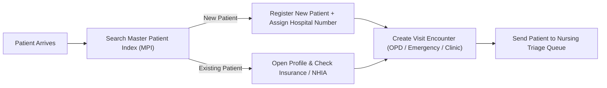
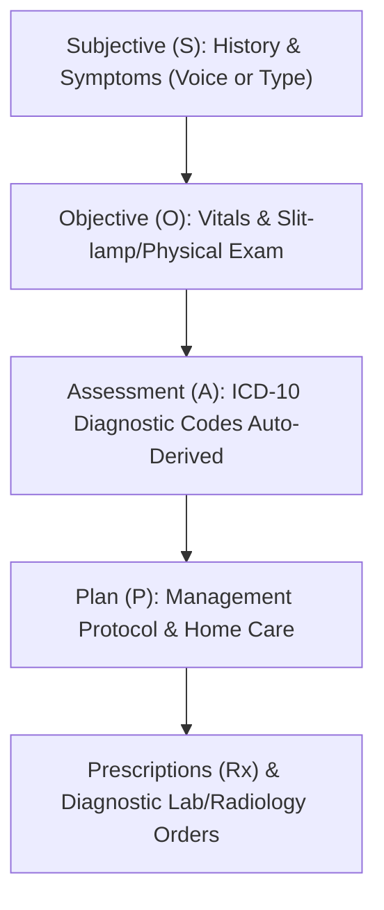

# Faith Foundation Hospital Management System (TerkHealth360)
## Complete Module-by-Module User Manual & Role Operational Guide

---

## Table of Contents
1. [Introduction & System Overview](#1-introduction--system-overview)
2. [Windows Desktop App Installation & Setup Guide](#2-windows-desktop-app-installation--setup-guide)
3. [Logging In, Navigation & Security Basics](#3-logging-in-navigation--security-basics)
4. [Role 1: Receptionist / Medical Records (Health Records Officer)](#4-role-1-receptionist--medical-records-health-records-officer)
   - *Patient Registration, Master Patient Index (MPI), Appointment Scheduling, Queue Check-In & Emergency Intake*
5. [Role 2: Nursing Staff (Triage, OPD Nurse, Ward Nurse, Labour Ward)](#5-role-2-nursing-staff-triage-opd-nurse-ward-nurse-labour-ward)
   - *Vital Signs Triage, Inpatient Bed Management, Medication Administration Record (MAR), Shift Handover*
6. [Role 3: Doctors & Specialists (General OPD, Eye Clinic, Dental, Surgery/Theatre)](#6-role-3-doctors--specialists-general-opd-eye-clinic-dental-surgerytheatre)
   - *Clinical Consultations, Voicebox Voice Dictation, SOAP Notes, ICD-10 Coding, Prescriptions, Lab & Imaging Orders*
7. [Role 4: Pharmacist & Pharmacy Dispensary](#7-role-4-pharmacist--pharmacy-dispensary)
   - *Prescription Verification, Dispensing Workflow, Batch & Expiry Tracking, Inventory Requisitions*
8. [Role 5: Laboratory Scientist & Technologist (LIMS / Pathology)](#8-role-5-laboratory-scientist--technologist-lims--pathology)
   - *Sample Collection, Test Processing, Analyzer Worklist, Result Validation & Sign-off*
9. [Role 6: Radiologist & Sonographer (Radiology & PACS Imaging)](#9-role-6-radiologist--sonographer-radiology--pacs-imaging)
   - *Imaging Orders, DICOM Viewer, Radiographic Findings, AI Voice Dictation Rewriter*
10. [Role 7: Cashier, Billing Officer & Health Insurance (NHIA / HMO)](#10-role-7-cashier-billing-officer--health-insurance-nhia--hmo)
    - *Point of Sale (POS) Invoicing, Copay Collections, HMO Pre-Authorization, Claims & Receipts*
11. [Role 8: Hospital Administrator, Medical Director & HR Manager](#11-role-8-hospital-administrator-medical-director--hr-manager)
    - *Staff Management, Duty Rostering, System Audits, Database Backups, Hospital Factory Reset*
12. [Troubleshooting & Frequently Asked Questions (FAQ)](#12-troubleshooting--frequently-asked-questions-faq)

---

## 1. Introduction & System Overview

**TerkHealth360 (Faith Foundation Hospital Management System)** is a comprehensive, enterprise-grade Electronic Medical Record (EMR) and Hospital Management System. It is engineered with a **zero-trust local-first architecture**, meaning clinical services, voice dictation, laboratory records, and billing operations run entirely inside the hospital local network (LAN) without requiring internet connectivity for core healthcare delivery.

### Key Architecture Highlights
- **Single Source of Truth**: A unified Master Patient Index (MPI) ensures no duplicate medical records exist across outpatient, emergency, dental, eye, theatre, and ward departments.
- **Role-Based Access Control (RBAC)**: Each hospital worker sees strictly what their job permits. A cashier cannot view private doctor clinical notes; a doctor cannot alter accounting ledger entries.
- **Voicebox AI Voice Bridge**: Offline neural voice dictation and hospital queue announcements running on local CPUs and hospital servers.

---

## 2. Windows Desktop App Installation & Setup Guide

This section is for installing the application on hospital computers (Windows 10 or Windows 11, 64-bit).

### Step 2.1: Building / Packaging the Windows Installer (For IT Department)
To generate the `.exe` installer setup file from the source repository:
1. Open PowerShell or Terminal on the primary development/server workstation.
2. Navigate to the frontend directory:
   ```bash
   cd /path/to/TerkHealth360/frontend
   ```
3. Run the packaging command:
   ```bash
   npm run dist:win
   ```
4. Once completed, the ready-to-distribute installer will be created inside the `release/` folder:
   - Example: `Faith Foundation Hospital Management System Setup 1.0.0.exe`

---

### Step 2.2: Installing on Hospital Client Laptops / Desktops (For Lay-Users)

> [!NOTE]
> No special programming or technical expertise is required to install the desktop application. Simply follow these steps:

1. **Copy the Installer**:
   - Insert the hospital USB Flash Drive containing `Faith Foundation Hospital Management System Setup.exe` into the computer, or download it from the hospital internal share folder.
2. **Run the Setup**:
   - Double-click `Faith Foundation Hospital Management System Setup.exe`.
   - If Windows SmartScreen displays a blue prompt saying *"Windows protected your PC"*, click **More info** and then click **Run anyway**.
3. **Automatic Installation**:
   - The installer installs the hospital system files in less than 30 seconds.
   - A blue hospital cross shortcut icon labeled **Faith Foundation Hospital** will appear automatically on your Windows Desktop and Start Menu.
4. **Connecting to the Hospital Central Server**:
   - On initial launch, the system automatically connects to the hospital server via your local LAN Wi-Fi or Ethernet cable.
   - If your facility uses a centralized hospital server IP (e.g., `http://192.168.1.100:3000`), confirm with your hospital IT administrator that your computer is connected to the hospital Wi-Fi or LAN cable.

---

## 3. Logging In, Navigation & Security Basics

### Logging In
1. Double-click the **Faith Foundation Hospital** icon on your desktop.
2. On the Login Screen:
   - Enter your **Username** or **Staff ID** (e.g., `doc_amara`, `nurse_chidinma`, `pharm_uche`).
   - Enter your **Password**.
   - Select your **Primary Working Facility / Branch** if prompted.
   - Click **Sign In to Hospital Portal**.
3. **Role Redirection**: The system automatically detects your professional role and opens your specific department dashboard.

### Navigation Overview
- **Left Sidebar**: Contains all clinical, operational, and financial modules assigned to your permission level. You can collapse it anytime by clicking the arrow at the top.
- **Top Header Bar**:
  - **Hospital Facility Pill**: Displays the current active hospital branch.
  - **Emergency Banner**: Notifies all staff instantly if an emergency code or critical lab alert is activated.
  - **Global Call & Voicebox Studio (Waveform Icon)**: Opens the clinical dictation pad and audio announcement studio.
  - **User Profile Avatar (Top-Right)**: Shows your name, current shift role, and allows you to **Lock Screen** or **Log Out**.

---

## 4. Role 1: Receptionist / Medical Records (Health Records Officer)

The Receptionist and Health Records team are the first point of clinical contact. They manage patient registrations, verify hospital IDs, and direct patients to queues.



### 4.1 Registering a New Patient
1. On the left sidebar, click **Outpatient Care (OPD)** or **Patient Registration**.
2. Click the green **+ New Patient Registration** button at the top-right.
3. Fill in the **Demographics**:
   - **First Name**, **Last Name**, **Gender**, and **Date of Birth** (or estimated Age).
   - **Phone Number** and **Physical Residential Address**.
   - **National Identification Number (NIN)** (if available).
   - **Emergency Contact Next of Kin** (Name, Relationship, Phone).
4. Select **Billing Category**:
   - `PRIVATE / OUT-OF-POCKET CASH`
   - `NATIONAL HEALTH INSURANCE (NHIA)`
   - `CORPORATE / HMO PRIVATE INSURANCE` (Select HMO provider and enter Enrollee Policy ID).
5. Click **Save & Generate Hospital Number**.
   - The system automatically creates a unique barcode and patient identifier (e.g., `PAT-2026-00142`).

---

### 4.2 Checking In a Patient & Creating an Encounter
1. In the search box at the top, type the patient's name, phone number, or hospital number.
2. Click **Start New Visit Encounter**.
3. Select the destination department:
   - `General OPD (Ambulatory)`
   - `Eye Clinic (Ophthalmology)`
   - `Dental Clinic`
   - `Emergency (Casualty / A&E)`
   - `Antenatal Clinic (ANC)`
4. Type the presenting reason (e.g., *"Routine follow-up"*, *"Severe fever and body pain"*).
5. Click **Check-In to Nursing Triage Queue**. The patient now automatically appears on the Nurse's screen.

---

## 5. Role 2: Nursing Staff (Triage, OPD Nurse, Ward Nurse, Labour Ward)

Nurses monitor patient flow, record vital signs, monitor inpatients, and record drug administration.

### 5.1 Recording Patient Triage & Vitals
1. Click **Nursing Workspace** or **Triage & Vitals Desk** on the left menu.
2. Click on the patient waiting in the queue.
3. Enter the patient's clinical baseline measurements:
   - **Systolic / Diastolic Blood Pressure (mmHg)** (e.g., `120/80`)
   - **Body Temperature (°C)** (e.g., `37.2`)
   - **Pulse Rate (bpm)** (e.g., `78`)
   - **Respiratory Rate (cpm)** (e.g., `18`)
   - **Oxygen Saturation (SpO₂ %)** (e.g., `98%`)
   - **Body Weight (kg)** and **Height (cm)** (The system computes BMI automatically).
4. **Automated NEWS2 Early Warning Alert**:
   - If blood pressure or oxygen saturation falls outside normal parameters, the system highlights the card in **Amber** or **Red** and flags the patient for immediate medical review.
5. Enter **Presenting Complaint**:
   - You can type or click **🎤 Voice Dictation** to speak the patient's complaint into the microphone.
6. Click **Save Vitals & Send to Doctor's Waiting Queue**.

---

### 5.2 Inpatient Ward & Bed Management (IPD)
1. On the left menu, select **Inpatient Care (IPD)** -> **Ward Beds Map**.
2. To admit a patient recommended for admission by a doctor:
   - Select the destination ward: *Male Medical Ward*, *Female Surgical Ward*, *Pediatric Ward*, or *ICU*.
   - Click on an empty green bed (e.g., `Bed 04 - Male Ward`).
   - Select the patient's name and click **Confirm Bed Allocation**.
3. **Electronic Medication Administration Record (e-MAR)**:
   - Click on the admitted patient's chart.
   - Switch to the **e-MAR / Prescriptions** tab.
   - When a prescribed dose is given to the patient, locate the scheduled medication (e.g., *IV Ceftriaxone 1g at 14:00*).
   - Click **Administer & Sign**. The nurse's electronic signature, date, and exact minute timestamp are permanently logged.

---

## 6. Role 3: Doctors & Specialists (General OPD, Eye Clinic, Dental, Surgery/Theatre)

Doctors conduct clinical assessments, review diagnostic investigations, make diagnoses, and prescribe medical therapies.

### 6.1 Conducting an Outpatient Consultation (SOAP Note Workflow)
1. In **Outpatient Care (OPD)**, select the patient from your **Waiting for Doctor** queue.
2. Click **Start Clinical Consultation**. The consultation drawer opens on the right:



3. **Step 1: Subjective (S) & Voicebox AI Dictation**:
   - Click the blue **`🎤 Voice Dictation`** button.
   - Speak into your microphone:
     > *"Patient presents with 4-day history of high fever, rigors, headache, and joint pain. No cough or vomiting."*
   - Click **`Stop Voice Dictation`**.
   - Voicebox transcribes the speech, automatically cleans conversational filler words (`um`, `uh`), and normalizes medical phrasing.
4. **Step 2: Objective (O)**:
   - Review pre-loaded triage vitals. Add physical examination notes (e.g., *"Chest clear, abdomen soft, no organomegaly"*).
5. **Step 3: Assessment (A) & Automatic ICD-10 Coding**:
   - Click **Smart Auto-Online Assessment & Plan**.
   - The system automatically matches symptoms to ICD-10 codes (e.g., `B50.9 — Plasmodium falciparum malaria & febrile illness`).
   - You can also type into the ICD search box to add secondary diagnoses.
6. **Step 4: Prescriptions & Diagnostic Orders**:
   - Switch to the **Prescriptions & Stock** tab: Type drug name (e.g., *Artemether-Lumefantrine*), choose dosage, frequency (*BD*), duration (*3 days*), and click **Add Rx**.
   - Switch to **Lab Orders & Availability**: Check required tests (e.g., *Malaria Parasite MP*, *Full Blood Count FBC*) and click **Issue Lab Order**.
7. Click the green button: **Save & Finalize OPD Consultation Note**.

---

### 6.2 Specialized Clinics: Eye Clinic & Dental Clinic
- **Eye Clinic (Ophthalmology)** ([EyeClinic.tsx](file:///Users/mac/Downloads/TerkHealth360/frontend/src/pages/EyeClinic.tsx)):
  - Enter **Visual Acuity (OD / OS)** (e.g., `6/6`, `6/18`).
  - Record **Intraocular Pressure (IOP)** by Tonometry.
  - Document Anterior Segment (Slit-lamp) and Posterior Segment (Fundoscopy).
- **Dental Clinic** ([DentalClinic.tsx](file:///Users/mac/Downloads/TerkHealth360/frontend/src/pages/DentalClinic.tsx)):
  - Interactive **FDI Odontogram**: Click directly on the adult or pediatric tooth chart (e.g., `#16`, `#46`) to record restorations, caries, extractions, or endodontic treatments.

---

## 7. Role 4: Pharmacist & Pharmacy Dispensary

Pharmacists verify clinical safety, check inventory availability, dispense medications, and issue dosage instructions.

### 7.1 Dispensing Doctor Prescriptions
1. On the left menu, click **Pharmacy** -> **Dispensary & Orders Queue**.
2. Select the patient from the **Pending Dispense Queue**.
3. **Verify Prescription Details**:
   - Review prescribed drug, dose, frequency, and total quantity.
   - If the patient has documented allergies in the system, a high-priority red alert appears automatically.
4. **Batch & Expiry Allocation**:
   - The system utilizes **First-Expiry, First-Out (FEFO)** inventory principles.
   - Select the active batch number from the inventory dropdown. The system displays current warehouse stock balance and shelf expiry date.
5. **Dispense**:
   - Click **Confirm Dispense & Deduct Stock**.
   - The stock is automatically deducted from the pharmacy store ledger.
6. **Patient Spoken Instructions**:
   - Click **Generate Spoken Care Guide** to produce clear audio dosage instructions for the patient.

---

## 8. Role 5: Laboratory Scientist & Technologist (LIMS / Pathology)

The Laboratory Information Management System (LIMS) tracks samples from phlebotomy through to result validation.

### 8.1 Phlebotomy & Sample Collection
1. On the left menu, select **LIMS & Laboratory** -> **Sample Collection**.
2. Look up the patient under **Awaiting Sample Collection**.
3. Verify test orders (e.g., *FBC, Lipid Profile, Urinalysis*).
4. Click **Collect Sample & Print Barcode Label**. Attach the generated barcode to the specimen tube.

### 8.2 Entering & Validating Test Results
1. Navigate to **Worklist & Processing**.
2. Select the accessioned sample number.
3. Enter test parameter values (e.g., *Hemoglobin: 13.5 g/dL*, *WBC: 6,400 /µL*).
4. **Reference Range Indicators**:
   - Results outside the biological reference interval are automatically marked with **[H] High** (Red) or **[L] Low** (Blue).
5. Click **Submit for Pathologist Review** or click **Validate & Electronically Sign Result**.
   - Once validated, the result is immediately visible to the requesting doctor in real time.

---

## 9. Role 6: Radiologist & Sonographer (Radiology & PACS Imaging)

The Radiology module manages X-ray, Ultrasound, CT, and MRI orders with a DICOM PACS viewer.

### 9.1 Processing Imaging Requests
1. Open **Radiology & PACS Scans** from the left navigation bar.
2. Select the patient under **Awaiting Imaging**.
3. Verify requested modality (*Chest X-Ray PA*, *Abdominal Pelvic Ultrasound*, *Dental OPG*).
4. Perform scan and upload DICOM image file into the patient's digital imaging record.

### 9.2 Drafting Radiological Reports with Voice Dictation
1. Open the patient's imaging request and click **Draft Radiologist Report**.
2. Under **Radiographic Findings**:
   - Use the built-in **`🎤 Voice Dictation`** button to speak your findings (e.g., *"Lungs are clear bilaterally. Cardiothoracic ratio is within normal limits. Costophrenic angles are sharp."*).
3. Under **Radiological Impression**:
   - Dictate your conclusive diagnostic opinion.
4. Click **Sign & Release Radiological Report**.

---

## 10. Role 7: Cashier, Billing Officer & Health Insurance (NHIA / HMO)

The Finance & Billing department oversees patient invoices, receipts, and health insurance pre-authorizations.

### 10.1 Invoicing Out-of-Pocket Cash Patients
1. Click **Billing & Cashier Desk** on the left menu.
2. Select patient under **Pending Payments**.
3. All consultation fees, lab investigations, imaging scans, and pharmacy items are aggregated into an automated itemized bill.
4. Click **Process Payment**:
   - Select payment method: `Cash`, `POS Card`, `Bank Transfer`, or `Mobile Money`.
   - Enter amount received.
5. Click **Complete Payment & Print Official Receipt**.
   - A digital audit receipt is generated with payment confirmation.

### 10.2 Processing Health Insurance (NHIA / Private HMO)
1. Under **Billing**, select the **HMO / Insurance Claims** tab.
2. Check authorization status for requested services.
3. If pre-authorization is required, enter the **HMO Authorization Code** provided by the insurer.
4. System automatically splits co-payments (e.g., 90% insurer liability, 10% patient copay) according to NHIA guidelines.

---

## 11. Role 8: Hospital Administrator, Medical Director & HR Manager

Administrators manage user security, staff rosters, enterprise analytics, database backups, and disaster recovery.

### 11.1 Staff Accounts & Role-Based Permissions
1. Go to **Security & IAM** -> **User Accounts & RBAC**.
2. To create a new hospital staff account:
   - Click **+ Add Staff User**.
   - Enter Full Name, Official Hospital Email, Username, and Temporary Password.
   - Assign Primary Role: `DOCTOR`, `NURSE`, `PHARMACIST`, `LAB_SCIENTIST`, `RADIOLOGIST`, `BILLING_OFFICER`, `RECEPTIONIST`, or `ADMIN`.
   - Toggle **Active Status** and click **Save User**.

---

### 11.2 Automated Database Backups & Manual Restores
Located under **System Architecture** -> **Infrastructure & Security**:
- **Automated Daily Backups**: The system automatically executes a daily database snapshot at `02:00 AM`, keeping strictly the **10 most recent backups** and automatically pruning older versions.
- **Trigger Manual Backup**: Click the yellow **Trigger Backup** button anytime before major maintenance.
- **Restore from Backup File**:
  - Click **Restore from File**.
  - Select your saved `.dump` file and confirm the action to restore patient records and hospital configuration.
- **Delete Backup**: You can manually click the delete icon on any snapshot row to manage disk storage.

---

### 11.3 Hospital Hard Reset (Factory Wipe)
Located under **Settings** -> **Hospital Deployment Reset**:
> [!CAUTION]
> **Complete Factory Reset**: This action permanently clears all operational patient records, consultation notes, laboratory tests, inpatient records, and financial invoices while preserving system configuration (Super Admin account, Drug Formulary, ICD-10 libraries, and facility master setups).
- Requires typing `HARD-RESET` in capital letters and confirming Super Admin credentials.

---

## 12. Troubleshooting & Frequently Asked Questions (FAQ)

### Q1: The microphone dictation button does not record my voice. What should I check?
1. Ensure your computer microphone is plugged in and not muted.
2. In Windows Settings -> **Privacy & Security** -> **Microphone**, ensure **"Let desktop apps access your microphone"** is set to **On**.
3. If accessing TerkHealth360 via a web browser on another computer over the hospital LAN, ensure the URL is using **HTTPS** (or `localhost`). Modern browsers block microphone access on insecure HTTP connections.

### Q2: Voicebox sidecar status shows "Hybrid Fallback Mode". Does voice dictation still work?
**Yes.** In Hybrid Fallback Mode, TerkHealth360 uses its built-in local Whisper speech-to-text engine. You can dictate patient notes without interruptions. If you launch the **Voicebox** desktop app on the hospital server, it will automatically switch to **Voicebox Sidecar Online**.

### Q3: A doctor cannot see their assigned patients in the OPD queue.
1. Check that the patient was properly triaged by the nurse and moved to the **Doctor Waiting Queue**.
2. Verify that the doctor has selected the correct department filter at the top of the OPD screen (e.g., *General OPD* vs. *Eye Clinic*).

### Q4: How do I export hospital statistical reports for Ministry of Health / NMRS?
1. On the left menu, select **Reports & Analytics** -> **NMRS Interoperability**.
2. Select reporting period (Month/Year) and click **Export FHIR / DHIS2 Statistical Report**.

---
*Faith Foundation Hospital Management System (TerkHealth360) — Built by Terk-Age LTD.*
