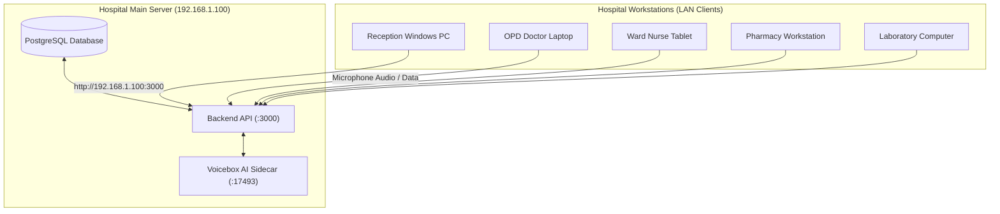
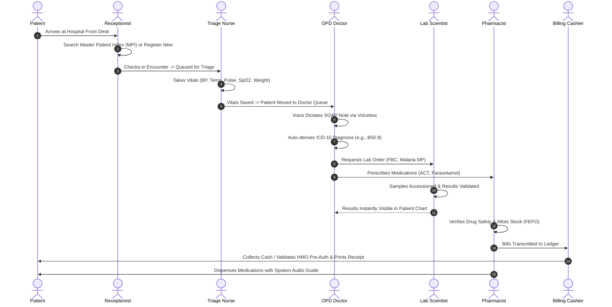
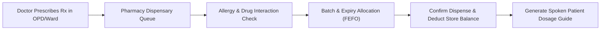

# TerkHealth360 (Faith Foundation Hospital Management System)
## Complete Master Installation Guide & Role-Based Departmental Operational Manual

---

## Document Information & System Metadata
- **System Version**: TerkHealth360 Enterprise v1.0.0 (Release 2026.1)
- **Deployment Architecture**: Local-First Hybrid EMR / Electron Desktop Client / High-Availability LAN Core
- **Hardware Profile Auto-Adaptation**: Full Support for Dedicated Servers, Apple Silicon MLX, Dedicated NVIDIA/AMD GPUs, and Standard CPU-Only Laptops (e.g., Dell Intel Core i5 with Integrated Graphics)
- **Compliance Standards**: NDPA (Nigeria Data Protection Act), WHO ICD-10 Classification, HL7 FHIR v4 Interoperability, NHIA (National Health Insurance Authority) Act 2022

---

## Table of Contents
1. [Master Installation & Deployment Guide (Windows, macOS, Linux)](#1-master-installation--deployment-guide-windows-macos-linux)
   - *1.1 Windows Desktop Installation (.exe)*
   - *1.2 Apple macOS Installation (.dmg / .app)*
   - *1.3 Linux Desktop Installation (.AppImage / .deb)*
   - *1.4 Connecting Client Laptops to the Central Hospital LAN Server*
2. [Hospital Cross-Cutting Clinical Architecture & Lifecycle Diagram](#2-hospital-cross-cutting-clinical-architecture--lifecycle-diagram)
   - *How a Patient Journey Flows Seamlessly Across All Modules*
3. [Core Security, Universal Navigation & Voicebox AI Studio](#3-core-security-universal-navigation--voicebox-ai-studio)
4. [Section A: Health Records Officers & Receptionists (Front Desk)](#4-section-a-health-records-officers--receptionists-front-desk)
   - *Modules: Master Patient Index (MPI), Patient Registration, Appointments, Visits, Queue Management*
5. [Section B: Nursing Staff (Triage, Inpatient Wards, Labour Ward, Emergency & ICU)](#5-section-b-nursing-staff-triage-inpatient-wards-labour-ward-emergency--icu)
   - *Modules: Nursing Dashboard, Triage Desk, Bed Allocation, e-MAR, Labour Ward, Emergency/Casualty, ICU*
6. [Section C: Medical Doctors & Clinical Specialists](#6-section-c-medical-doctors--clinical-specialists)
   - *Modules: Outpatient Care (OPD), Clinical SOAP Note, Voicebox AI Dictation, ICD-10 Auto-Derivation, Eye Clinic, Dental Clinic, Surgical Theatre, Telemedicine*
7. [Section D: Pharmacy & Inventory Supply Chain Management (SCM)](#7-section-d-pharmacy--inventory-supply-chain-management-scm)
   - *Modules: Pharmacy Dispensary, Drug Safety & Allergies, Narcotics Control, Inventory SCM, Procurement, Cold-Chain & FEFO Expiry Tracking*
8. [Section E: Laboratory Information Management System (LIMS / Pathology)](#8-section-e-laboratory-information-management-system-lims--pathology)
   - *Modules: Sample Phlebotomy & Barcoding, Analyzer Worklists, Reference Range Validation, Critical Alerts, Blood Bank & Cross-Matching*
9. [Section F: Radiology & PACS Digital Medical Imaging](#9-section-f-radiology--pacs-digital-medical-imaging)
   - *Modules: Imaging Worklist, DICOM Web Viewer, Voice-Assisted Radiographic Findings & Impressions*
10. [Section G: Billing, Cashier, Finance & Health Insurance (NHIA / HMO)](#10-section-g-billing-cashier-finance--health-insurance-nhia--hmo)
    - *Modules: Point of Sale (POS) Invoicing, NHIA / HMO Pre-Authorization, Financial General Ledger, Asset Register, Financial Audits*
11. [Section H: Hospital Administration, HR, Medical Director & IT System Engineers](#11-section-h-hospital-administration-hr-medical-director--it-system-engineers)
    - *Modules: Security & IAM, User Management, Duty Roster & Attendance, Automated Backups, NMRS/DHIS2 Interoperability, Factory Hard Reset*
12. [Troubleshooting & Frequently Asked Questions (FAQ)](#12-troubleshooting--frequently-asked-questions-faq)

---

# 1. Master Installation & Deployment Guide (Windows, macOS, Linux)

TerkHealth360 is built as a native multi-platform desktop application using Electron, powered by a high-throughput Node/Express backend and a responsive React frontend.

---

### 1.1 Windows Desktop Installation (.exe)
**Target Operating Systems**: Windows 11, Windows 10 (64-bit editions).

#### Step 1: Generating the Windows Installer (For Hospital IT Administrator)
On the build machine or central server:
```bash
cd /path/to/TerkHealth360/frontend
npm run dist:win
```
This produces `release/Faith Foundation Hospital Management System Setup 1.0.0.exe`.

#### Step 2: Layman Installation on Windows Client Laptops / Desktops
1. **Copy the Installer**: Transfer `Faith Foundation Hospital Management System Setup 1.0.0.exe` via the hospital USB flash drive or download it from the hospital internal network share (`\\192.168.1.100\HospitalApps`).
2. **Double-Click Setup**: Run the `.exe` file.
3. **Handle Windows Defender / SmartScreen**:
   - If Windows displays a blue screen stating: *"Windows protected your PC — Microsoft Defender SmartScreen prevented an unrecognized app from starting"*:
   - Click the small underlined link: **More info**.
   - Click the button: **Run anyway**.
4. **Automated Setup**:
   - The installer automatically creates application binaries in `%LocalAppData%\Programs\Faith Foundation Hospital Management System`.
   - A blue Hospital Cross icon will appear on the **Windows Desktop** and in the **Start Menu**.
5. **Launch**: Double-click the desktop shortcut to launch TerkHealth360.

---

### 1.2 Apple macOS Installation (.dmg / .app)
**Target Operating Systems**: macOS 12 (Monterey), macOS 13 (Ventura), macOS 14 (Sonoma), macOS 15 (Sequoia) on Apple Silicon (M1/M2/M3/M4) and Intel Macs.

#### Step 1: Generating the macOS Installer (For Hospital IT Administrator)
```bash
cd /path/to/TerkHealth360/frontend
npm run dist:mac
```
This outputs `release/Faith Foundation Hospital Management System-1.0.0.dmg`.

#### Step 2: Layman Installation on Apple MacBooks / iMacs
1. **Mount DMG**: Double-click `Faith Foundation Hospital Management System-1.0.0.dmg`. A window opens showing the **Hospital App Icon** and the **Applications** folder shortcut.
2. **Drag and Drop**: Drag the `Faith Foundation Hospital` icon into the **Applications** folder.
3. **Eject Disk Image**: Right-click the mounted disk image on your desktop and select **Eject**.
4. **First Launch (Gatekeeper Verification)**:
   - Open Finder -> **Applications** -> Double-click **Faith Foundation Hospital**.
   - If macOS displays *"Apple cannot check it for malicious software"* or *"Unidentified Developer"*:
     1. Open **System Settings** (or System Preferences).
     2. Click **Privacy & Security**.
     3. Scroll down to the **Security** section where you will see: *"Faith Foundation Hospital was blocked from use because it is not from an identified developer"*.
     4. Click **Open Anyway** and enter your Mac password.
5. **Microphone Permissions (Mandatory for Voicebox AI Dictation)**:
   - When the app launches, macOS will prompt: *"Faith Foundation Hospital would like to access the microphone"*. Click **OK**.

---

### 1.3 Linux Desktop Installation (.AppImage / .deb)
**Target Operating Systems**: Ubuntu 20.04/22.04/24.04 LTS, Debian 11/12, Linux Mint, Fedora, Red Hat Enterprise Linux.

#### Step 1: Generating the Linux Package (For Hospital IT Administrator)
```bash
cd /path/to/TerkHealth360/frontend
npm run dist:linux
```
This generates both:
- `release/Faith-Foundation-Hospital-1.0.0.AppImage` (Universal Portable Linux Binary)
- `release/faith-foundation-hospital_1.0.0_amd64.deb` (Debian/Ubuntu Package)

#### Step 2: Layman Installation on Ubuntu / Debian Workstations
**Option A: Using the Portable AppImage (No installation required)**:
1. Copy `Faith-Foundation-Hospital-1.0.0.AppImage` to your Home or Desktop folder.
2. Right-click the file -> **Properties** -> **Permissions** tab -> Check **"Allow executing file as program"**.
   *(Or via terminal: `chmod +x Faith-Foundation-Hospital-1.0.0.AppImage`)*.
3. Double-click the file to immediately launch the hospital system.

**Option B: Installing via Debian Package (`.deb`)**:
1. Open terminal in the download folder and execute:
   ```bash
   sudo dpkg -i faith-foundation-hospital_1.0.0_amd64.deb
   sudo apt-get install -f   # Fixes any missing system libraries
   ```
2. The application is now permanently installed in `/opt/Faith Foundation Hospital` and searchable in your Linux Application Launcher under **Medical / Office**.

---

### 1.4 Connecting Client Laptops to the Central Hospital LAN Server

In standard hospital operation, one primary computer serves as the **Hospital Database & Voicebox Server** (e.g., in the Server Room or Medical Director's Office at LAN IP `192.168.1.100`), while ward and clinic laptops connect over the secure hospital Wi-Fi/Ethernet.



#### Configuring the Client Desktop App to Point to the Server:
1. On any client laptop, navigate to the installed directory or check the `frontend/.env.production` file.
2. Set the `VITE_API_URL` to the server's static hospital IP:
   ```env
   VITE_API_URL=http://192.168.1.100:3000/api
   ```
3. When staff open the app, it instantly connects to the centralized server, meaning patient records entered at Reception are visible in OPD within milliseconds.

---

# 2. Hospital Cross-Cutting Clinical Architecture & Lifecycle Diagram

The diagram below illustrates how a single patient admission flows across all eight hospital departments without duplicate data entry:



---

# 3. Core Security, Universal Navigation & Voicebox AI Studio

### 3.1 Security & Role-Based Access Control (RBAC)
Every staff member is given an authenticated user profile with cryptographic session tokens.
- **Data Confidentiality**: Only licensed clinicians can view subjective consultation notes.
- **Audit Logging**: Every button click, patient edit, prescription deletion, or billing cancellation is cryptographically recorded in **Audit Logs** with user ID, IP address, and timestamp.
- **Screen Lock**: If leaving your computer unattended, click your Avatar at the top right and click **Lock Screen**.

### 3.2 Voicebox AI Voice Studio (Waveform Icon)
Located in the top header bar next to the emergency banner:
- **Zero-Cloud Audio Processing**: All transcription runs inside the hospital premises. No patient voice data leaves the hospital building.
- **Hardware-Aware Filter**: Automatically identifies whether the computer has an Apple Silicon chip, an NVIDIA GPU, or is a standard CPU-only laptop (e.g., Dell Core i5). On CPU-only laptops, it restricts models to lightweight **Kokoro 82M** (~350 MB) and **Whisper Small** (~150 MB) to ensure fast operation without overheating.

---

# 4. Section A: Health Records Officers & Receptionists (Front Desk)

**Assigned Staff**: Medical Records Clerks, Receptionists, Front Desk Executives.  
**Key Modules**: `Patient Registration`, `Patients (MPI)`, `Visits`, `Appointments`, `Queue Management`.

```
┌─────────────────────────────────────────────────────────────────────────────┐
│                      RECEPTION & RECORDS WORKSPACE                          │
├─────────────────────┬───────────────────────────┬───────────────────────────┤
│ 1. Search MPI       │ 2. Register New Patient   │ 3. Check-In & Queue       │
│ Name, Phone, NIN,   │ Demographics, Next of Kin,│ Assign to OPD, Eye, Dental│
│ or Hospital ID      │ Insurance / Cash category │ Casualty or ANC Triage    │
└─────────────────────┴───────────────────────────┴───────────────────────────┘
```

### Step-by-Step Operational Instructions:
1. **Searching the Master Patient Index (MPI)**:
   - When a patient approaches the desk, always type their surname, phone number, or national NIN in the top search bar first.
   - *Rule*: Never create a duplicate file if the patient already exists in the system.
2. **Registering a First-Time Patient**:
   - Click **+ New Patient Registration**.
   - Input **Bio-data**: Surname, First Name, Gender, Date of Birth (or estimated age).
   - Input **Contact**: Phone Number, Residential Address, State/LGA of Origin.
   - Input **Next of Kin**: Name, Relationship (e.g., Spouse, Parent), Contact Phone.
   - Select **Payer Category**:
     - *Private Out-of-Pocket Cash*: Standard self-pay.
     - *National Health Insurance (NHIA)*: Enter NHIA Registration Number and select Enrollee Type.
     - *Corporate HMO*: Select HMO Company (e.g., Hygeia, Reliance, AXA Mansard) and enter Policy ID.
   - Click **Save & Generate Hospital Number**. The system issues an automated identifier (e.g., `PAT-2026-00412`).
3. **Queue Check-In**:
   - Click **Start Encounter**. Select the requested clinic: `General OPD`, `Eye Clinic`, `Dental Clinic`, `ANC Maternity`, or `Emergency`.
   - Click **Send to Nursing Triage**. The patient is now queued on the nurse's station screen.

---

# 5. Section B: Nursing Staff (Triage, Inpatient Wards, Labour Ward, Emergency & ICU)

**Assigned Staff**: Registered Nurses (RN), Midwives (RM), Matrons, Triage Nurses.  
**Key Modules**: `Nursing Dashboard`, `Triage Desk`, `Inpatient Care (IPD)`, `Labour Ward`, `ICU`, `Emergency`.

### 5.1 Outpatient Triage & Vital Signs Desk
1. Open **Nursing Dashboard** -> **Triage & Vitals Desk**.
2. Select the patient from the **Waiting for Vitals** list.
3. Enter vital sign measurements:
   - **Blood Pressure**: Systolic and Diastolic in mmHg.
   - **Temperature**: In Celsius (e.g., `37.4`).
   - **Pulse Rate**: Beats per minute.
   - **Respiratory Rate**: Breaths per minute.
   - **Oxygen Saturation (SpO₂)**: Percentage (e.g., `98%`).
   - **Weight & Height**: System automatically calculates BMI ($kg/m^2$).
4. **Automated NEWS2 Clinical Early Warning Scoring**:
   - The system automatically tallies the National Early Warning Score.
   - If SpO₂ drops below 92% or systolic BP exceeds 180 mmHg, the card turns **RED** and sounds a triage alert.
5. Record **Presenting Complaints**: Type or use **🎤 Voice Dictation** to speak the patient's complaints.
6. Click **Save Vitals & Send to Doctor's Waiting Queue**.

### 5.2 Inpatient Bed Management & Electronic MAR (e-MAR)
1. Navigate to **Inpatient Care (IPD)** -> **Ward Beds Map**.
2. **Bed Allocation**: Select the ward (*Male Medical*, *Female Surgical*, *Pediatric*, *Maternity*). Click any green bed, search the admitted patient's name, and click **Confirm Bed Allocation**.
3. **Medication Administration (e-MAR)**:
   - Click the patient's active bed card.
   - View scheduled doses ordered by the attending physician (e.g., *IV Ceftriaxone 1g at 14:00*).
   - When administered, click **Administer & Sign**. The nurse's credential and timestamp are logged permanently.

---

# 6. Section C: Medical Doctors & Clinical Specialists

**Assigned Staff**: Medical Officers, Resident Doctors, Consultants, Ophthalmologists, Dental Surgeons.  
**Key Modules**: `Outpatient Care (OPD)`, `Eye Clinic`, `Dental Clinic`, `Surgical Theatre`, `Specialty Disease Clinics`.

### 6.1 Clinical Consultation Drawer & Voicebox Dictation (SOAP Workflow)
In **Outpatient Care (OPD)**, select a patient from the **Waiting for Consultation** queue:

```
┌─────────────────────────────────────────────────────────────────────────────┐
│                           DOCTOR'S SOAP NOTE DRAWER                         │
├─────────────────────────────────────────────────────────────────────────────┤
│ [🎤 Voice Dictation]   [✨ Smart Auto-Online Assessment & Plan]             │
│                                                                             │
│ [S] Subjective: History of Presenting Complaint (Spoken or Typed)           │
│ [O] Objective:  Vitals review, Systemic & Physical Examination              │
│ [A] Assessment: ICD-10 Diagnostic Codes (Auto-Derived from Symptoms)        │
│ [P] Plan:       Clinical Management Guidelines & Patient Instructions       │
│                                                                             │
│ [Tabs]: [Prescriptions & Stock]  [Lab Orders]  [Radiology Scans]  [Admit]   │
└─────────────────────────────────────────────────────────────────────────────┘
```

1. **Subjective (S) with Voicebox AI**:
   - Click the blue **`🎤 Voice Dictation`** button.
   - Speak clearly into your computer microphone:
     > *"Patient presents with complaints of persistent fever and chills for three days, severe frontal headache, and joint pains. No vomiting or diarrhea."*
   - Click **`Stop Voice Dictation`**.
   - Voicebox Whisper transcribes the audio, automatically strips conversational fillers (`um`, `uh`, stutters), and formats it into formal clinical language.
2. **Objective (O)**:
   - Add targeted examination notes (e.g., *"Chest clear bilaterally, abdomen soft, non-tender"*).
3. **Assessment (A) & ICD-10 Coding**:
   - Click **✨ Smart Auto-Online Assessment & Plan**.
   - The clinical NLP engine matches symptoms to WHO ICD-10 codes (e.g., `B50.9 — Plasmodium falciparum malaria & febrile illness`, `R51.9 — Headache`).
4. **Plan (P), Prescriptions & Orders**:
   - In the **Prescriptions & Stock** tab: Search drug formulary, select dosage (*1 cap*), frequency (*TDS*), and duration (*5 days*). Click **Add Rx**.
   - In the **Lab Orders & Availability** tab: Check necessary investigations (*Malaria MP*, *Full Blood Count*).
5. Click **Save & Finalize OPD Consultation Note**.

### 6.2 Eye Clinic (Ophthalmology)
Navigate to **Eye Clinic** ([EyeClinic.tsx](file:///Users/mac/Downloads/TerkHealth360/frontend/src/pages/EyeClinic.tsx)):
- Record **Visual Acuity**: Right Eye (OD) and Left Eye (OS) for uncorrected, pinhole, and best corrected vision.
- Record **Tonometry (IOP)**: Intraocular pressure in mmHg.
- Document Slit-Lamp Biomicroscopy and Fundoscopy findings.

### 6.3 Dental Clinic & Odontogram
Navigate to **Dental Clinic** ([DentalClinic.tsx](file:///Users/mac/Downloads/TerkHealth360/frontend/src/pages/DentalClinic.tsx)):
- Interactive **FDI Tooth Chart**: Click on specific tooth numbers (e.g., `#16`, `#46`) to record caries, root canal treatments, extractions, or periodontal pocket depths.

---

# 7. Section D: Pharmacy & Inventory Supply Chain Management (SCM)

**Assigned Staff**: Pharmacists, Pharmacy Technicians, Store Keepers.  
**Key Modules**: `Pharmacy Dispensary`, `Inventory SCM`, `Drug Safety & Allergies`, `Procurement`.



### Step-by-Step Operational Instructions:
1. **Prescription Verification**:
   - Open **Pharmacy** -> **Dispensary Queue**.
   - Select the patient. The system flags known drug allergies in **RED**.
2. **Batch Allocation & Stock Deduction**:
   - The system uses **FEFO (First-Expiry, First-Out)** principles.
   - Select the active batch from the dropdown. View remaining stock balance and batch expiration date.
3. **Dispensing**:
   - Click **Confirm Dispense & Deduct Stock**.
   - The quantity is deducted from the pharmacy sub-store inventory.
4. **Voice Care Guide**:
   - Click **Generate Spoken Care Guide** to allow Voicebox to generate spoken instructions for the patient regarding drug timing, dosage, and side effects.

---

# 8. Section E: Laboratory Information Management System (LIMS / Pathology)

**Assigned Staff**: Medical Laboratory Scientists (MLS), Technicians, Pathologists.  
**Key Modules**: `LIMS & Laboratory`, `Pathology`, `Blood Bank`.

1. **Phlebotomy & Sample Accessioning**:
   - Open **LIMS** -> **Sample Collection**.
   - Locate the ordered test. Click **Collect Sample & Generate Barcode**.
   - Affix the printed specimen barcode to the blood/urine container.
2. **Entering Test Results**:
   - Open **Worklist & Processing**. Click on the accessioned test.
   - Enter numeric parameter values (e.g., *WBC: 7.2 x 10^9/L*, *Hemoglobin: 14.1 g/dL*).
   - Values exceeding physiological reference intervals are highlighted with **[H] High** or **[L] Low**.
3. **Validation & Sign-Off**:
   - Click **Validate & Electronically Sign Result**.
   - The result immediately synchronizes with the ordering doctor's OPD and ward chart.

---

# 9. Section F: Radiology & PACS Digital Medical Imaging

**Assigned Staff**: Consultant Radiologists, Sonographers, Radiographers.  
**Key Modules**: `Radiology & PACS Scans`.

1. **Worklist Execution**:
   - Open **Radiology** -> **Imaging Worklist**.
   - Verify clinical indication and modality (*X-Ray*, *Ultrasound*, *CT*, *MRI*).
2. **Uploading Scans & DICOM Viewer**:
   - Upload DICOM scan files.
   - Use the built-in web PACS viewer to adjust window leveling, zoom, measure distances, and compare anatomical structures.
3. **Drafting Reports with AI Voice Dictation**:
   - Under **Radiographic Findings**, click **`🎤 Voice Dictation`** to speak your observations.
   - Under **Radiological Impression**, dictate your clinical conclusion.
   - Click **Sign & Release Radiological Report**.

---

# 10. Section G: Billing, Cashier, Finance & Health Insurance (NHIA / HMO)

**Assigned Staff**: Cashiers, Medical Billing Officers, HMO Desk Officers, Hospital Accountants.  
**Key Modules**: `Billing & Cashier Desk`, `Insurance Portal (NHIA/HMO)`, `Finance & General Ledger`.

```
┌─────────────────────────────────────────────────────────────────────────────┐
│                            BILLING & CASHIER DESK                           │
├─────────────────────────────────────────────────────────────────────────────┤
│ 1. Aggregate Invoices: Automatically groups OPD, Lab, Pharmacy & Bed fees   │
│ 2. Payment Method: Cash / POS Card / Bank Transfer / Mobile Money           │
│ 3. Health Insurance: Auto-splits 90% HMO Coverage vs 10% Patient Copay      │
│ 4. Output: Prints Cryptographically Signed Audit Receipt                    │
└─────────────────────────────────────────────────────────────────────────────┘
```

1. **Processing Out-of-Pocket Cash Invoices**:
   - Open **Billing** -> **Pending Payments**.
   - Select patient. The invoice aggregates all consultations, lab tests, and dispensed medications.
   - Select payment channel (*Cash*, *POS*, *Direct Transfer*).
   - Click **Complete Payment & Print Official Receipt**.
2. **National Health Insurance (NHIA) & HMO Pre-Authorization**:
   - Open **Insurance Portal**.
   - Input the **HMO Pre-Authorization Code** received from the insurance desk.
   - The system automatically handles co-payment splits (e.g., 90% HMO liability, 10% patient copay) and prepares claims for monthly reconciliation.

---

# 11. Section H: Hospital Administration, HR, Medical Director & IT System Engineers

**Assigned Staff**: Hospital Administrators, Medical Directors, HR Executives, IT System Administrators.  
**Key Modules**: `Security & IAM`, `User Management`, `Workforce HR & Rosters`, `Infrastructure & Security`, `Settings`.

### 11.1 Managing Staff Accounts & Permissions
1. Navigate to **Security & IAM** -> **User Accounts & RBAC**.
2. Click **+ Add Staff User**.
3. Enter Name, Official Email, Username, Password, and Role (`DOCTOR`, `NURSE`, `PHARMACIST`, `LAB_SCIENTIST`, `RADIOLOGIST`, `BILLING_OFFICER`, `RECEPTIONIST`, `ADMIN`).
4. Click **Save User**.

### 11.2 Automated Database Backups & Recovery
Located under **System Architecture** -> **Infrastructure & Security**:
- **Automated Daily Backups**: Executes every morning at `02:00 AM`, keeping strictly the **10 most recent backups** and automatically removing older snapshots to preserve disk storage.
- **Manual Backup**: Click the yellow **Trigger Backup** button anytime before system maintenance.
- **Restore from File**: Click **Restore from File**, select a previously saved `.dump` file, and confirm to restore records.

### 11.3 Hospital Hard Reset (Factory Wipe)
Located under **Settings** -> **Hospital Deployment Reset**:
> [!CAUTION]
> Typing `HARD-RESET` wipes operational clinical encounters, inpatient visits, and bills for new hospital commissioning, while preserving your Super Admin login, Drug Formulary, and ICD-10 libraries.

---

# 12. Troubleshooting & Frequently Asked Questions (FAQ)

### Q1: The microphone dictation button does not record my voice. What should I check?
1. Ensure your physical microphone is connected and not muted.
2. In Windows Settings -> **Privacy & Security** -> **Microphone**, ensure desktop app microphone access is enabled.
3. On macOS, ensure System Settings -> **Privacy & Security** -> **Microphone** has `Faith Foundation Hospital` toggled **ON**.
4. If accessing via a web browser over the LAN, modern browsers block microphone access on unencrypted `http://`. Ensure you are using the installed **Electron Desktop App** or an `https://` local certificate.

### Q2: Can the system run when internet cables are completely disconnected?
**Yes.** TerkHealth360 is engineered as a **100% local-first hospital EMR**. All database queries, vital signs tracking, e-MAR, billing, and offline Whisper/Voicebox voice transcriptions run inside your hospital LAN with zero internet dependencies.

### Q3: How do we back up hospital data to an external hard drive?
1. Open **System Architecture** -> **Infrastructure & Security**.
2. Under **Disaster Recovery (DR) Database Snapshots**, locate the latest snapshot and click the **Download** icon.
3. Copy the downloaded `.dump` file to your external encrypted drive.

---
*Faith Foundation Hospital Management System (TerkHealth360) — Built by Terk-Age LTD.*
